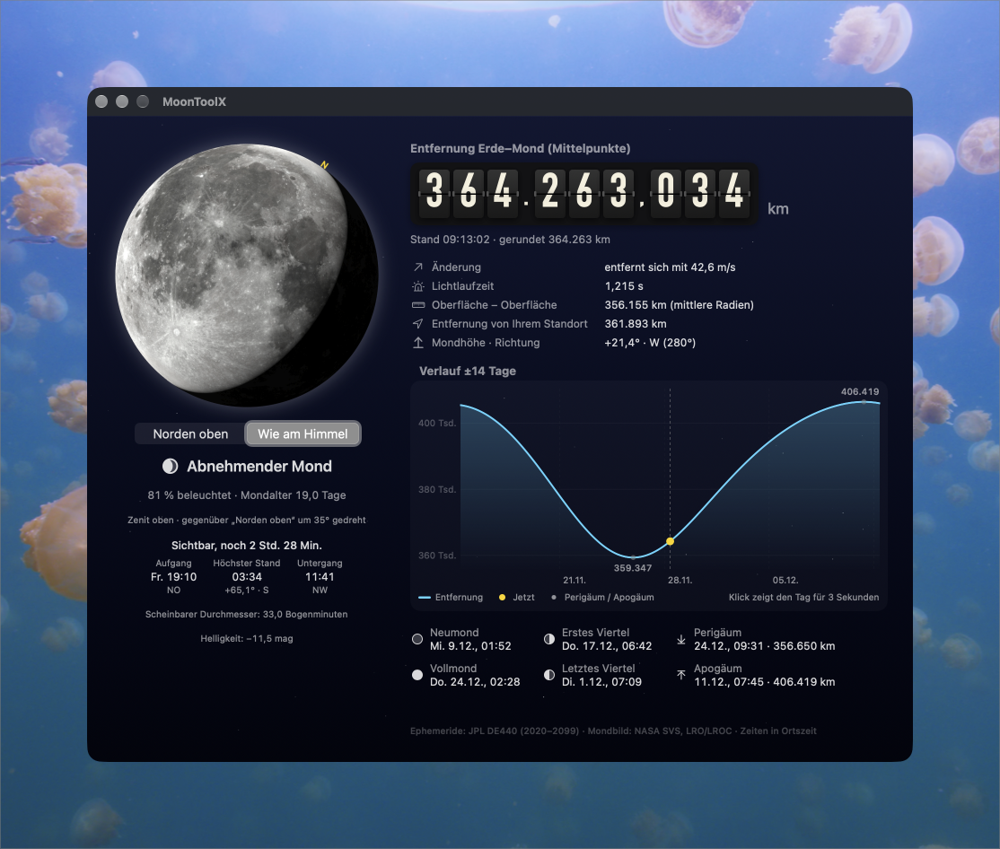

# MoonToolX

macOS-27-Widget und App: Entfernung Erde–Mond (Mittelpunkte), sekundengenau berechnet, mit Mondphase.

*English: [README.md](README.md)*

**Download:** [MoonToolX 1.0 (notarisiertes DMG)](https://github.com/wombat-26/MoonToolX/releases/latest)

- **Ephemeride:** JPL DE440 (2021, aktueller Stand der JPL-Planeten- und Mondephemeriden), geozentrischer Mond als
  Tschebyschow-Reihen (`Shared/moon_de440.bin`, 2020–2099). Rechnerische Abweichung zur DE440 unter 1 mm; UTC → TT mit 69,184 s.
  Gegenprüfung mit JPL Horizons (DE441, Vektortabelle, Erdmittelpunkt–Mondmittelpunkt): Abweichung unter 1 m.
- **Mond wie am Himmel:** Umschalter unter dem Mondbild; dreht das Bild um P − q (Positionswinkel der Mondachse nach
  Meeus Kap. 53 minus parallaktischer Winkel), sodass der Zenit oben liegt. Abgleich mit JPL Horizons (NP.ang, vier Orte,
  2026–2099): P auf unter 0,05°; q gegen unabhängige Vektorrechnung geprüft.
- **Auf- und Untergang:** oberer Rand mit 34′ Refraktion, höchster Stand als Meridiandurchgang; Suche in 10-Minuten-Schritten,
  Bisektion auf 1 s. Abgleich mit JPL Horizons (R_T_S, drei Orte, 2026 und 2035, 53 Ereignisse): höchstens 1 Minute.
  Dazu Sichtbarkeit („Sichtbar, noch …“ / „Aufgang in …“) und scheinbarer Durchmesser in Bogenminuten.
- **Entfernung vom Standort:** Mac-Standort (CoreLocation, nur lokal) als WGS84-Punkt, über wahre Sternzeit, Nutation
  (Hauptterme) und Präzession (IAU 1976) ins Bezugssystem der Ephemeride gedreht; dazu Mondhöhe und Himmelsrichtung (Azimut).
  Abgleich mit JPL Horizons (topozentrische Vektoren, drei Orte, 2026–2099): Entfernung unter 0,1 km, Höhe und Azimut unter 0,001°.
- **Sonne:** Meeus Kap. 25 (≈ 0,01°) für Phase, Beleuchtung und Phasenzeiten (Minutengenauigkeit).
- **Widget:** Timeline-Einträge genau zu den Sekunden, in denen die km-Anzeige umspringt, plus ein Eintrag pro Minute.
  Eine Timeline reicht 60 Minuten (24 Reloads/Tag).
- **Mondbilder:** zur Laufzeit berechnet (`Shared/MoonRenderer.swift`) aus der NASA-SVS-Karte LRO/LROC (CGI Moon Kit,
  gemeinfrei), Lunar-Lambert-Photometrie, Erdschein; Mondnordpol oben, Phase stufenlos, mit Libration.
  Die App rechnet vom Standort aus (Karte 4096 × 2048), das Widget vom Erdmittelpunkt aus (Karte 2048 × 1024,
  ein Bild je Timeline).
- **Helligkeit:** scheinbare visuelle Helligkeit nach Allen (V = 0,23 + 5 lg(r·Δ) + 0,026 α + 4·10⁻⁹ α⁴), vom Standort aus,
  ohne Atmosphäre. Abgleich mit JPL Horizons (APmag, Vollmond bis Neumond): Abweichung unter 0,002 mag.
- **Libration:** Mondorientierung nach IAU/WGCCRE 2009 einschließlich physischer Libration (`Shared/MoonAspect.swift`).
  Abgleich mit JPL Horizons (Scheibenmittelpunkt, Sonnenpunkt, Positionswinkel der Achse; geozentrisch und München,
  2026–2031): Abweichung unter 0,01°.

## Werkzeuge
- `Tools/main.swift` – Gegenprüfung gegen DE440-Referenzwerte:
  `swiftc -O Shared/Astronomy.swift Shared/MoonAspect.swift Tools/main.swift -o /tmp/moonverify && /tmp/moonverify`
- `Tools/make_ephem.py` – erzeugt die Ephemeride neu.
- Mondkarten `Shared/moon_map_4k.jpg` und `Shared/moon_map_2k.jpg`: aus `lroc_color_poles_4k.tif` und
  `lroc_color_poles_2k.tif` (NASA SVS, CGI Moon Kit) mit
  `sips -s format jpeg -s formatOptions 88 lroc_color_poles_4k.tif --out Shared/moon_map_4k.jpg` (2k: Qualität 90).
- `Tools/make_icon.py` – erzeugt die Ebenen des Liquid-Glass-Icons `App/AppIcon.icon` (Icon Composer).
- `Tools/make_dmg_background.py` – erzeugt den DMG-Hintergrund `Config/dmg/background*.png` (Layout in `Config/dmg/settings.py`).

### Wann müssen die Werkzeuge laufen?
Keines der Werkzeuge gehört zum normalen Build. Die erzeugten Dateien liegen im Repository; die Skripte laufen nur,
wenn sich ihre jeweilige Quelle ändert.

| Werkzeug | Wann | Wie oft |
|---|---|---|
| `Tools/main.swift` | nach jeder Änderung an `Shared/Astronomy.swift` oder `Shared/MoonAspect.swift` (Ephemeride, Phasen, Supermond-Logik, Libration) und vor jedem Release als Sicherheitscheck | bei Bedarf, vor jedem Release |
| `Tools/make_ephem.py` | wenn Zeitraum oder Genauigkeit der Ephemeridendaten geändert werden sollen; die Daten decken nur einen begrenzten Zeitraum ab und müssen danach neu erzeugt werden | praktisch einmalig, später bei Zeitraum-Ende |
| `Tools/make_icon.py` | wenn das Icon-Design geändert wird | selten |
| `Tools/make_dmg_background.py` | wenn DMG-Design oder -Layout geändert werden (dann auch `Config/dmg/settings.py` prüfen) | selten |

Die mitgelieferte Ephemeride (`Shared/moon_de440.bin`) gilt vom **31.12.2019 bis 04.01.2100**. Außerhalb dieses Zeitraums liefert die
Berechnung keine Werte. Für einen anderen Zeitraum `start_jd` und `end_jd` in `Tools/make_ephem.py` anpassen und das Skript neu ausführen:
`python3 Tools/make_ephem.py de440s.bsp Shared/moon_de440.bin` (benötigt `jplephem` und `numpy`). Die Quelldatei
[`de440s.bsp`](https://naif.jpl.nasa.gov/pub/naif/generic_kernels/spk/planets/de440s.bsp) von JPL/NAIF (32 MB, nicht im
Repository) reicht von 1849 bis 2150.

Automatisch laufen `Tools/bump_build.sh` (bei jedem Build, als Pre-Action im Schema) und `Tools/release.sh` (einmal pro Release).

## Sprachen
Englisch (Entwicklungs- und Rückfallsprache), Deutsch, Spanisch, Französisch, Italienisch, Niederländisch und Japanisch,
über String-Kataloge: `Shared/Localizable.xcstrings` für App und Widget, `App/InfoPlist.xcstrings` für den Standort-Hinweis
und den Anzeigenamen. Neue Texte stehen im Code auf Englisch; Xcode trägt sie beim Bauen in den Katalog ein, die
Übersetzungen kommen dort hinzu. Zahlen, Datum und Uhrzeit folgen automatisch der Region des Systems.

Begriffe, die auch in macOS vorkommen, folgen Apples eigenen Übersetzungen (abgeglichen mit den Lokalisierungstabellen
des Systems): Mondphasen, Mondaufgang und -untergang, Beleuchtung (Wetter-App), „Widgets bearbeiten …“
(Mitteilungszentrale), Ortungsdienste, Datenschutz & Sicherheit, Bewegung reduzieren (Systemeinstellungen) und das
Menü „Fenster“. Ausnahme: Die deutschen Phasennamen bleiben astronomisch („Zunehmende Sichel“, „Erstes Viertel“ …),
Apples Wetter-App zählt die Phasen anders. Französisch mit geschützten Leerzeichen vor „:“, „?“ und „›“.

Der Install-DMG ist sprachneutral: Der Hintergrund enthält keinen Text, nur Pfeil und Symbole, die Verknüpfung heißt
„Applications“.

## Version und Build-Nummer
Version und Build stehen in `Config/Version.xcconfig`. Jeder Build über das Schema **MoonToolX** (Xcode oder
`xcodebuild -scheme MoonToolX`) zählt `CURRENT_PROJECT_VERSION` per Pre-Action (`Tools/bump_build.sh`) um 1 hoch;
App und Widget erhalten dieselbe Nummer.

## Weitergabe außerhalb des App Store
`zsh Tools/release.sh` archiviert, signiert mit Developer ID, lässt die App von Apple notarisieren, heftet das Ticket an
und erzeugt `build/release/MoonToolX-<Version>-<Build>.dmg` (mit Verknüpfung „Applications“ auf den Ordner Programme)
sowie ein ZIP. Nach einer Änderung am DMG-Hintergrund `Config/dmg/background.tiff` löschen; das Skript erzeugt sie aus den PNGs neu.
Optional notarisiert das Skript auch den DMG selbst, wenn im Schlüsselbund das notarytool-Profil `MoonToolX-notary` liegt
(einmalig: `xcrun notarytool store-credentials MoonToolX-notary --apple-id <Apple-ID> --team-id 76X3T92345`).
Voraussetzung: in Xcode › Einstellungen › Accounts angemeldet. Exportoptionen: `Config/ExportOptions-DeveloperID.plist`.

November 2026, Matthias Eckardt
