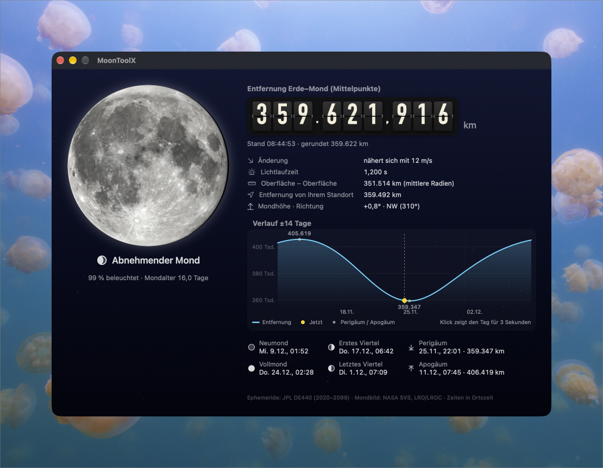

# MoonToolX

macOS-27-Widget und App: Entfernung Erde–Mond (Mittelpunkte), sekundengenau berechnet, mit Mondphase.

**Download:** [MoonToolX 1.0 (notarisiertes DMG)](https://github.com/wombat-26/MoonToolX/releases/latest)

- **Ephemeride:** JPL DE440 (2021, aktueller Stand der JPL-Planeten- und Mondephemeriden), geozentrischer Mond als
  Tschebyschow-Reihen (`Shared/moon_de440.bin`, 2020–2099). Rechnerische Abweichung zur DE440 unter 1 mm; UTC → TT mit 69,184 s.
  Gegenprüfung mit JPL Horizons (DE441, Vektortabelle, Erdmittelpunkt–Mondmittelpunkt): Abweichung unter 1 m.
- **Entfernung vom Standort:** Mac-Standort (CoreLocation, nur lokal) als WGS84-Punkt, über wahre Sternzeit, Nutation
  (Hauptterme) und Präzession (IAU 1976) ins Bezugssystem der Ephemeride gedreht; dazu Mondhöhe und Himmelsrichtung (Azimut).
  Abgleich mit JPL Horizons (topozentrische Vektoren, drei Orte, 2026–2099): Entfernung unter 0,1 km, Höhe und Azimut unter 0,001°.
- **Sonne:** Meeus Kap. 25 (≈ 0,01°) für Phase, Beleuchtung und Phasenzeiten (Minutengenauigkeit).
- **Widget:** Timeline-Einträge genau zu den Sekunden, in denen die km-Anzeige umspringt, plus ein Eintrag pro Minute.
  Eine Timeline reicht 60 Minuten (24 Reloads/Tag).
- **Mondbilder:** 180 Phasen (2°-Raster) aus der NASA-SVS-Karte LRO/LROC (CGI Moon Kit, gemeinfrei),
  Lunar-Lambert-Photometrie, Erdschein; Norden oben, Blick von der Nordhalbkugel, mittlere Libration.

## Werkzeuge
- `Tools/main.swift` – Gegenprüfung gegen DE440-Referenzwerte:
  `swiftc -O Shared/Astronomy.swift Tools/main.swift -o /tmp/moonverify && /tmp/moonverify`
- `Tools/make_ephem.py`, `Tools/render_moon.py`, `Tools/make_assets.py` – erzeugen Ephemeride, Phasenbilder und Assets neu.
- `Tools/make_icon.py` – erzeugt die Ebenen des Liquid-Glass-Icons `App/AppIcon.icon` (Icon Composer).
- `Tools/make_dmg_background.py` – erzeugt den DMG-Hintergrund `Config/dmg/background*.png` (Layout in `Config/dmg/settings.py`).

### Wann müssen die Werkzeuge laufen?
Keines der Werkzeuge gehört zum normalen Build. Die erzeugten Dateien liegen im Repository; die Skripte laufen nur,
wenn sich ihre jeweilige Quelle ändert.

| Werkzeug | Wann | Wie oft |
|---|---|---|
| `Tools/main.swift` | nach jeder Änderung an `Shared/Astronomy.swift` (Ephemeride, Phasen, Supermond-Logik) und vor jedem Release als Sicherheitscheck | bei Bedarf, vor jedem Release |
| `Tools/make_ephem.py` | wenn Zeitraum oder Genauigkeit der Ephemeridendaten geändert werden sollen; die Daten decken nur einen begrenzten Zeitraum ab und müssen danach neu erzeugt werden | praktisch einmalig, später bei Zeitraum-Ende |
| `Tools/render_moon.py`, `Tools/make_assets.py` | wenn Mondtextur, Phasenbilder oder Rendering geändert werden | praktisch einmalig |
| `Tools/make_icon.py` | wenn das Icon-Design geändert wird | selten |
| `Tools/make_dmg_background.py` | wenn DMG-Design oder -Layout geändert werden (dann auch `Config/dmg/settings.py` prüfen) | selten |

Die mitgelieferte Ephemeride (`Shared/moon_de440.bin`) gilt vom **31.12.2019 bis 04.01.2100**. Außerhalb dieses Zeitraums liefert die
Berechnung keine Werte. Für einen anderen Zeitraum `start_jd` und `end_jd` in `Tools/make_ephem.py` anpassen und das Skript neu ausführen:
`python3 Tools/make_ephem.py de440s.bsp Shared/moon_de440.bin` (benötigt `jplephem` und `numpy`). Die Quelldatei
[`de440s.bsp`](https://naif.jpl.nasa.gov/pub/naif/generic_kernels/spk/planets/de440s.bsp) von JPL/NAIF (32 MB, nicht im
Repository) reicht von 1849 bis 2150.

Automatisch laufen `Tools/bump_build.sh` (bei jedem Build, als Pre-Action im Schema) und `Tools/release.sh` (einmal pro Release).

## Version und Build-Nummer
Version und Build stehen in `Config/Version.xcconfig`. Jeder Build über das Schema **MoonToolX** (Xcode oder
`xcodebuild -scheme MoonToolX`) zählt `CURRENT_PROJECT_VERSION` per Pre-Action (`Tools/bump_build.sh`) um 1 hoch;
App und Widget erhalten dieselbe Nummer.

## Weitergabe außerhalb des App Store
`zsh Tools/release.sh` archiviert, signiert mit Developer ID, lässt die App von Apple notarisieren, heftet das Ticket an
und erzeugt `build/release/MoonToolX-<Version>-<Build>.dmg` (mit Alias auf den Ordner Programme) sowie ein ZIP.
Voraussetzung: in Xcode › Einstellungen › Accounts angemeldet. Exportoptionen: `Config/ExportOptions-DeveloperID.plist`.

November 2026, Matthias Eckardt
